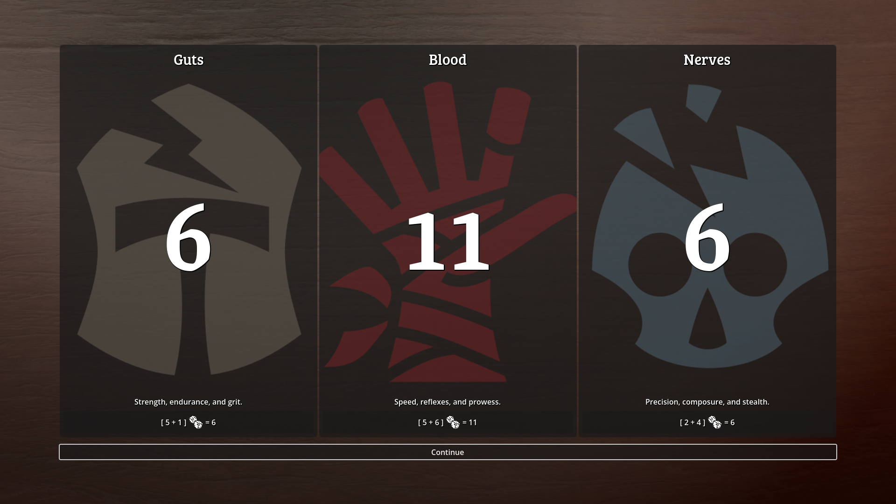
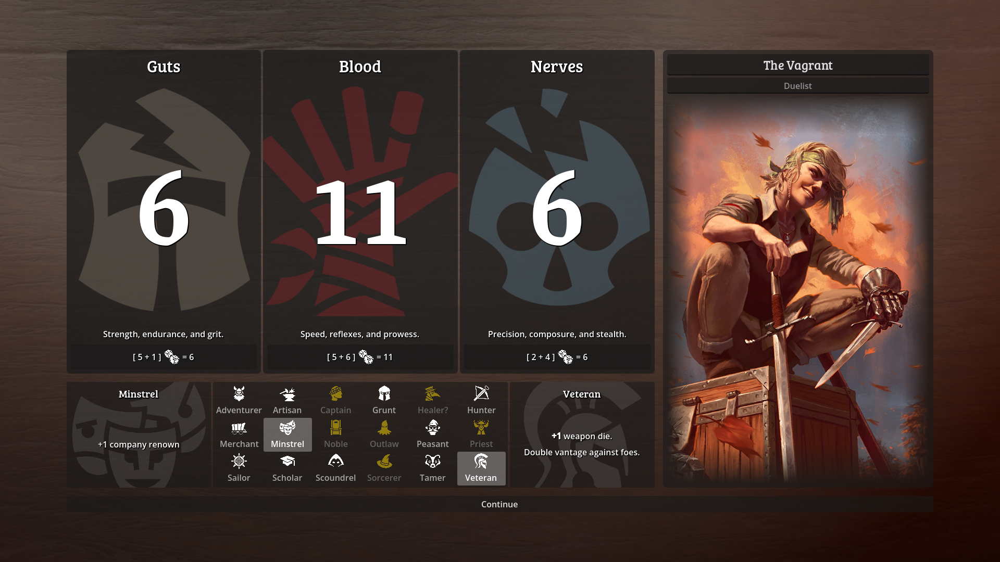
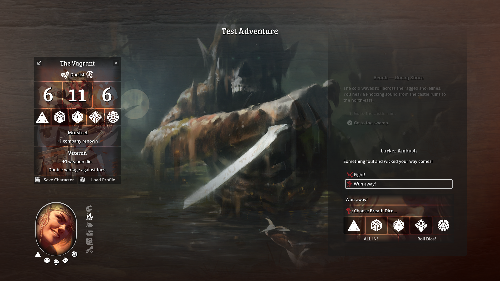
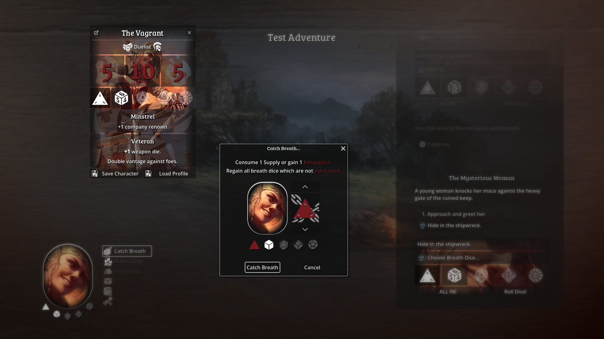

# Vagrant

This is a digital prototype for a physical Pen & Paper RPG with the current working title "Vagrant."

## Rolling Attributes

Character attributes are a simple **[2d6]** roll.

## Character Creation

Each character chooses **2** origins from a list of origins with abilities and starting gear, one representing the world into which they were born, one representing the world or role they chose or were resigned to in their adult life.

For each **double** rolled for attributes, choose a rare origin.

## Adventuring

The digital version is a Choose-Your-Own-Adventure game with dice checks and combat. Locations, the events that can happen there and the people and creatures met on the way make up an adventure; what the player did changes what comes next.

## Fights

A fight is a series of exchanges: both sides threaten with an attribute, roll their breath dice and weapons, and what gets through becomes an injury. Shields and armour can take blows, at a cost to the gear. Injuries lower attributes until a character can no longer resist.

## Items

Characters carry gear (weapons, armour, shields) and other items; adventures can hand them out, take them away, ask for them, and leave loot behind.

## Resting

The RPG uses a **breath dice** mechanic to represent a character's available effort and exhaustion.

## Saving

Each run is saved automatically as it goes, and the story book keeps the pages read so far.

## Working on it

- **Godot 4.6** (GDScript). Open the project in the editor, or run it with `godot --path .`.
- **Rules:** `obsidian_vault/Vagrant/WIP 5/` holds the tabletop rules; `Rules Reference.md` there is what the game implements.
- **Tools in the editor:** the *Adventure* tab edits an adventure as a map of its locations and events; the *Fight Lab* panel simulates fights.
- **While playing** (debug builds): F10 opens a debug panel with the story's log, its state and the saved runs.
- **Tests:** gdUnit4 suites in `tests/unit` and `tests/integration`; GitHub runs them, the linter and a script check on every push.
- `CLAUDE.md` describes the code's layout and conventions in more detail.
